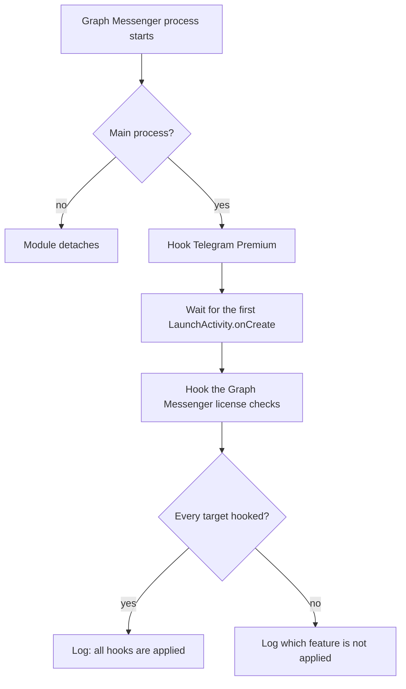
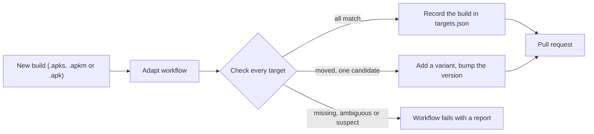

# GMX

**Graph Messenger Xposed** is a minimal LSPosed module for Graph Messenger (`ir.ilmili.telegraph`). It turns on local Premium for the Telegram features built into the app and passes Graph Messenger's own license checks.

There is nothing to configure: no interface, no settings, no background work. Enable the module, restart the app, and read one line in the log.


> [!NOTE]
> GMX changes only what the app reports on your device. It does not touch Telegram's or Graph Messenger's servers, so features that depend on server-side entitlements are unaffected.

**Using GMX:** [Quick start](#quick-start) · [Compatibility](#compatibility) · [What it changes](#what-it-changes) · [Reading the log](#reading-the-log) · [Troubleshooting](#troubleshooting)

**Understanding GMX:** [How it works](#how-it-works) · [Hook targets](#hook-targets-and-version-handling)

**Maintaining GMX:** [New Graph Messenger builds](#adapting-to-a-new-graph-messenger-build) · [Releases](#releases) · [Development](#development) · [Workflows](#workflows) · [Tools](#tools-reference) · [Layout](#project-layout)

## Quick start

1. Download the APK from the [latest release](../../releases/latest) and install it.
2. In LSPosed, enable **GMX** and select **Graph Messenger** as its only scope.
3. Force-stop Graph Messenger and open it again.
4. Open the module log in the LSPosed manager. It should contain `all hooks are applied`.

Each release provides two builds, each with a `.sha256` checksum file:

| File | Description |
|---|---|
| `GMX-v<version>.apk` | Signed release build. Use this one normally. |
| `GMX-v<version>-debug.apk` | Debug build: not minified, signed with a debug key. Its stack traces contain readable names, so use it when investigating a problem. |

> [!IMPORTANT]
> Both builds have the same package name and the same hooks but different signing keys, so Android cannot update one with the other. Uninstall the installed build before switching.

## Compatibility

| Requirement | Value |
|---|---|
| Android | 9 (API 28) or newer |
| Framework | Official LSPosed v2.1.0 or newer, which provides libxposed API 102 |
| App | Graph Messenger, package `ir.ilmili.telegraph` |

`minSdk` is 28 because official LSPosed requires Android 9 or newer. The module declares `minApiVersion=102`, so the LSPosed manager flags an LSPosed build that is too old. Target and compile SDK are 37.

| Graph Messenger build | Status |
|---|---|
| 13.0.2.0 | Device-tested |

The supported builds and the exact methods used for each are listed in [`SUPPORTED.md`](SUPPORTED.md), which is generated from [`targets.json`](targets.json). Other builds are not blocked: GMX hooks every target that matches the installed build exactly and reports the rest, so a build that changed only some targets keeps working partially (see [Reading the log](#reading-the-log)).

## What it changes

| Target | Group | Effect |
|---|---|---|
| `premium` | telegram | The client-side Premium flag of the signed-in user reports `true`. |
| `expire` | telegraph | The license expiry check reports `not expired`. |
| `days` | telegraph | The remaining-days check reports `999`. |
| `license` | telegraph | The license validity check reports `valid`. |
| `remove` | telegraph | The instance-removal check reports `true`. |

A *target* is one method the module hooks. The *group* decides how the result is worded in the log: `telegram` is Telegram Premium, `telegraph` is Graph Messenger's license system.

## Reading the log

Once every target has been tried, GMX writes a short summary to the LSPosed module log under the tag `GMX`.

| Level | Message | Meaning | What to do |
|---|---|---|---|
| INFO | `all hooks are applied` | Every target matched and is active. | Nothing. |
| INFO | `telegram premium is applied`<br>`telegraph premium is applied` | That feature is fully active. Shown only when the other one is not. | See the other line. |
| ERROR | `telegram premium is not applied` | The Telegram Premium target was not found in this build. | [Adapt to the build](#adapting-to-a-new-graph-messenger-build). |
| ERROR | `telegraph premium is not applied` | None of the Graph Messenger license targets were found. One line, however many failed. | Check the DEBUG lines, then adapt. |
| ERROR | `telegraph premium is partially applied` | Some, but not all, license targets were found. | The DEBUG lines name the missing ones. |
| WARN | `no hooks are applied, module is idle` | Nothing matched, and the module detached itself. | Update the module or adapt it to the build. |

Per-hook details (which class and method were chosen, why one failed) are logged at DEBUG level to keep the summary short. If they are missing from the log, enable verbose logging in LSPosed.

## How it works



**Timing.** The Premium hook is installed as soon as the package is ready. The four license targets are native methods, which have to be hooked after their library is loaded, otherwise loading can overwrite the hook. GMX therefore installs them on the first `LaunchActivity.onCreate`, then lets that method continue unchanged. If `LaunchActivity.onCreate` cannot be resolved, the native hooks are installed immediately.

**Exact match.** A target is hooked only if the class exists, the method has exactly the expected parameter types, the return type (or a structural marker such as "the class holds a `TLRPC$User` field") fits, and a native target really is native. Anything else is skipped and logged, so a renamed or changed method is never hooked by accident.

**Constant results.** A hooked method returns a fixed value and the original does not run. The value is converted to the method's real return type (`boolean`, `int`, `long` or `void`), which libxposed requires to be exact.

### Design

- **Minimal performance impact.** GMX has no screens, services, threads, listeners, files, caches or network access. It does its real work once, when Graph Messenger's main process starts: a few class lookups and one pass over each target class's declared methods, then the hooks are installed. All other processes of the app detach from the module immediately. Afterwards a hooked call returns a value prepared in advance, and nothing is looked up, logged or written. The per-call cost is the framework's own hook dispatch plus that return.
- **Simplicity.** All behavior lives in one logic class of about 200 lines with no bundled libraries and a single rule: match exactly or do nothing. Fewer moving parts mean fewer ways to fail, and the module can be read in one sitting.
- **Adaptability.** Hook targets are data, not code. Supporting a renamed method is a change to `targets.json`, a new constant-result hook is one JSON entry plus a regeneration, and a [workflow](#adapting-to-a-new-graph-messenger-build) finds moved targets in new builds and proposes the update.

## Hook targets and version handling

[`targets.json`](targets.json) is the single source of truth. Each target lists one or more *variants* (a class and method name), newest first, and each variant records the Graph Messenger builds it was seen in:

```json
{
  "id": "premium",
  "group": "telegram",
  "variants": [
    {"class": "org.telegram.messenger.v40", "method": "w", "versions": ["13.0.2.0"]}
  ]
}
```

- A name that did not change between builds is stored once. A new build only adds its version number to the variant.
- At runtime the module does not read the Graph Messenger version. It tries a target's variants in order and hooks the first exact match.
- `python3 tools/adapt.py gen` generates `Targets.java` (the table the module compiles against) and `SUPPORTED.md` from `targets.json`. Both are committed, and CI verifies they are current.

## Adapting to a new Graph Messenger build

When Graph Messenger is re-obfuscated, a target such as the Premium method receives a new name. The **Adapt to Graph build** workflow detects this and proposes the update as a pull request.



The tool extracts `base.apk`, reads its version, and checks every target with the same rules the module applies at runtime. Each target gets one status:

| Status | Meaning | Result |
|---|---|---|
| OK | A known variant matches. | The build is added to that variant's version list. |
| MOVED | No variant matches, but the trusted fingerprint finds exactly one method. | A new variant is added in front of the old ones. |
| SUSPECT | A variant matches by signature but the fingerprint disagrees. | Nothing changes. The workflow fails. |
| AMBIGUOUS | The fingerprint finds several methods. | Nothing changes. The workflow fails. |
| MISSING | Nothing matches, or the fingerprint is not trusted yet. | Nothing changes. The workflow fails. |

The *fingerprint* of the Premium target is a no-argument boolean method, in a class that holds a `TLRPC$User` field, that reads `TLRPC$User.premium`. It becomes trusted the first time it finds exactly the known target on a build where that target also matched by name, which is already the case for 13.0.2.0. A moved target is never relocated before that.

**Running it.** Open **Actions > Adapt to Graph build** and enter a direct URL of the bundle, or push a bundle to `apks/` (GitHub rejects pushes over 100 MB, so a URL is usually easier). Running it again on a recorded build changes nothing.

> [!WARNING]
> A static match is not a device test. Test a relocated target on a device before releasing it.

## Releases

A release starts in one of two ways:

- **Automatically**, when a change to `gradle.properties` reaches `main` and no tag exists yet for that version.
- **Manually**, by pushing a tag `v<GMX_VERSION_NAME>`, for example `v1.0.0`.

The **Release** workflow builds the signed release APK and the debug APK, verifies both signatures with `apksigner`, writes the release notes and publishes both APKs with their checksums. The module version is bumped only when the compiled hook table changes, so recording a build that needs no code change never produces a release. The first version is **1.0.0** (version code 100).

Signing needs four repository secrets:

| Secret | Content |
|---|---|
| `KEYSTORE_BASE64` | Release keystore, base64 encoded |
| `KEYSTORE_PASSWORD` | Keystore password |
| `KEY_ALIAS` | Key alias |
| `KEY_PASSWORD` | Key password |

Add them before the first push to `main`. That push contains `gradle.properties` and can start the release workflow for version 1.0.0, which fails without the secrets.

**Release notes** are a short bullet list generated by `tools/changelog.py`. They contain only new, useful information: builds that became supported since the previous release (marked "not device-tested" when that applies) and subjects of commits that changed the module itself. Documentation, CI and generated-file commits are left out.

```
- Added support for Graph Messenger 13.1.0.0 (not device-tested).
- Fix log wording
```

The first release reads `Initial release. Supports Graph Messenger 13.0.2.0.` A release with nothing to report says `No user-facing changes.` A problem reading `targets.json` never blocks a release: the affected part is left out and a warning appears in the workflow run.

## Development

```bash
./gradlew :app:assembleDebug                          # JDK from .java-version, Android SDK 37
python3 -m unittest discover -s tools -p 'test_*.py'  # tool tests, standard library only
python3 tools/adapt.py gen --check                    # generated files match targets.json
```

`pip install -r tools/requirements.txt` (androguard) is needed only for `tools/adapt.py analyze`.

Every version is declared in exactly one place:

| What | Declared in | Updated by |
|---|---|---|
| Android Gradle Plugin, libxposed API | `gradle/libs.versions.toml` | Dependabot |
| Gradle | `gradle/wrapper/gradle-wrapper.properties` | Dependabot, or `./gradlew wrapper --gradle-version` |
| GitHub Actions | `uses:` lines in `.github/workflows/` | Dependabot |
| androguard | `tools/requirements.txt` | Dependabot |
| JDK used by the build | `.java-version` | Toolchain watch workflow |
| Python used by tools and workflows | `.python-version` | Toolchain watch workflow |
| `minSdk`, `targetSdk`, `compileSdk`, Java bytecode level | `app/build.gradle.kts` | Manually |
| SDK build tools | Not pinned: AGP uses its own tested version | With AGP |

Dependabot cannot change a JDK or Python version, because those are workflow inputs and not dependencies. The Toolchain watch workflow therefore builds and tests the project with the newest stable JDK and Python every week and opens a pull request only if everything passes.

The JDK that runs the build and the bytecode level are separate settings. The module is compiled to Java 17 bytecode, which Android's D8 desugars for every supported device, whichever JDK runs the build.

## Workflows

| Workflow | Trigger | Purpose |
|---|---|---|
| CI | Push to `main`, pull requests | Runs the tool tests, checks that generated files are current, builds debug and release. |
| Adapt to Graph build | Manual (with a URL), push to `apks/` | Checks a build against `targets.json` and opens a pull request. |
| Toolchain watch | Weekly, manual | Tests the newest stable JDK and Python and opens a pull request if they pass. |
| Auto release | Push to `main` that changes `gradle.properties` | Starts the Release workflow if the version has no tag yet. |
| Release | Tag `v*`, started by Auto release | Builds, signs, verifies and publishes the release. |

The Adapt and Toolchain workflows open pull requests, which requires **Settings > Actions > General > Allow GitHub Actions to create and approve pull requests**. Pull requests opened with the built-in token do not start CI, so both workflows run the build and tests themselves before opening a pull request.

## Tools reference

All tools are in `tools/` and use only the standard library, except `adapt.py analyze`, which needs androguard.

| Command | Description |
|---|---|
| `python3 tools/adapt.py analyze FILE [--apply] [--report PATH] [--version V]` | Checks a `.apks`, `.apkm` or `.apk` against `targets.json`. Without `--apply` it only reports. With `--apply` it records the build, relocates moved targets, regenerates the generated files and bumps the module version if the compiled table changed. Exit code 0 means every target matched, 2 means at least one target needs a person. |
| `python3 tools/adapt.py gen [--check]` | Generates `Targets.java` and `SUPPORTED.md` from `targets.json`. With `--check` it changes nothing and exits with 1 if they are out of date. |
| `python3 tools/changelog.py --tag TAG [--prev TAG] [--ref REF] [--repo-dir DIR]` | Prints the release notes for `TAG`, comparing against the previous `v*` tag. |
| `python3 tools/toolchain.py compare FILE LATEST [--parts N]` | Prints `current=`, `latest=` and `newer=` for a version file (`.java-version`, `.python-version`). `--parts` is the number of numeric components that count: 1 for a JDK, 2 for Python. |
| `python3 tools/toolchain.py bump FILE VERSION` | Writes a version into a version file. |

## Project layout

```
.
├── .java-version, .python-version    JDK and Python used by every workflow
├── targets.json                      hook targets by Graph Messenger build (source of truth)
├── SUPPORTED.md                      generated: supported builds and the methods they use
├── app/src/main/
│   ├── java/com/usmanzade/gmx/
│   │   ├── GmxModule.java            module entry point: resolve, hook, log
│   │   ├── Target.java               one hook target
│   │   └── Targets.java              generated from targets.json
│   ├── resources/META-INF/xposed/    module.prop, scope.list, java_init.list
│   └── res/                          name, description and icon
├── tools/                            adapt.py, changelog.py, toolchain.py, requirements.txt, tests
└── .github/workflows/                ci, adapt, toolchain, auto-release, release
```

## Troubleshooting

For problems that the [log summary](#reading-the-log) explains, follow its last column. For everything else:

| Symptom | Likely cause | What to do |
|---|---|---|
| No `GMX` lines in the log | Module disabled, wrong scope, or the app was not restarted | Enable GMX, scope Graph Messenger only, force-stop the app. |
| The module does not install | Android older than 9 (API 28) | Not supported by official LSPosed either. |
| Android refuses to update the app | Release and debug builds use different signing keys | Uninstall the installed build first. |
| Release notes warn that `targets.json` is not valid JSON | A broken edit such as a trailing comma or a leftover merge-conflict marker | Fix the line shown in the warning. CI fails on it too. |

When reporting a problem, include the Graph Messenger version, the Android and LSPosed versions, and the `GMX` log lines including DEBUG. The debug build gives the most readable output.

## License

GPL-3.0, see [LICENSE](LICENSE). GMX is an unofficial community project and is not affiliated with Telegram or Graph Messenger. Use it at your own risk.
